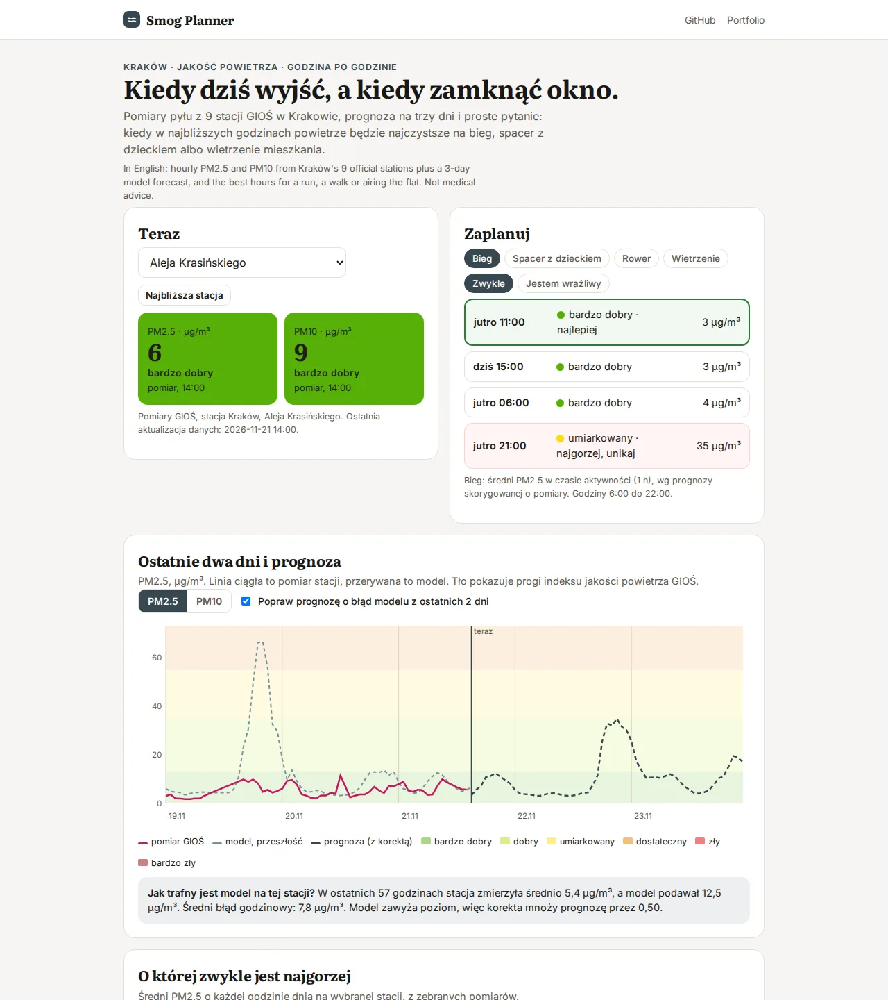

# Smog Planner

**Hourly PM2.5 and PM10 from Kraków's official stations, a 3-day forecast checked against the measurements, and the best hours for a run, a walk with a child or airing the flat.**

**Current version:** 0.1.1

Live: https://kostasxeras.com/smog-planner/



## The question

In Kraków's heating season the question is not "is the air bad today" but "when in the next day is it least bad". Most air quality apps show a coloured dot for right now. I wanted an app that answers the planning question, shows the official measurements next to the forecast, and is honest about how good the forecast is at each station.

## Who it is for

- People in Kraków who run, cycle or walk with children outdoors in winter
- Parents deciding when to air a flat or go to the playground
- Hiring managers who want to see how I build a product on live public data with real constraints

## What is inside

- **Now**: latest measured PM2.5 and PM10 at the chosen station, coloured by the official Polish air quality index, with the time of the measurement
- **Planner**: the three best start times in the next 36 hours (6:00 to 22:00) for a run, a walk with a child, a bike ride or airing the flat, and the time to avoid. A "sensitive" setting raises the bar
- **Chart**: two days of measurements and model, three days of forecast, with index bands in the background
- **Model check**: how far the forecast model was from the station in the last two days, and an optional correction by the measured ratio (limited to 0.5 to 2)
- **Daily pattern**: average PM2.5 by hour of day from the collected history (grows hourly, kept for 60 days)
- **Nearest station** by location, and a label on stations without hourly measurements
- **Hourly data job**: a GitHub Action copies GIOŚ measurements for 9 Kraków stations into the repo, because the GIOŚ API cannot be read from a browser page
- Polish interface

## Main findings

Full detail in the [case study](docs/case-study.md).

- **The official API cannot be used from a web page** (confirmed). Browser requests to the GIOŚ API fail, while the same addresses open directly. Requests also failed with HTTP 406 until the Accept header allowed any type. Hence the hourly job.
- **Not every station publishes hourly PM data** (confirmed). On the first run, 4 of the 9 Kraków stations returned hourly PM2.5 or PM10, and only Aleja Krasińskiego returned both. The other sensors answered HTTP 400. The app labels those stations "forecast only".
- **The model can be far from the station** (early observation, one station, about two days). On 21 November 2026, over the previous 56 hours at Aleja Krasińskiego, the station measured 5.4 µg/m³ of PM2.5 on average and the CAMS model 12.6 µg/m³, a mean hourly gap of 7.9 µg/m³. One clean-air period at one station is not a pattern. Findings across stations need a few weeks of history: [result].

## Data and sources

Measurements: GIOŚ, State Environmental Monitoring, via the [GIOŚ API](https://api.gios.gov.pl/pjp-api/swagger-ui/), current and unverified data, Polish local time. Forecast: CAMS (Copernicus Atmosphere Monitoring Service) via the [Open-Meteo Air Quality API](https://open-meteo.com/en/docs/air-quality-api). Index bands: [Instytut Ochrony Środowiska](https://ios.edu.pl/en/air-quality-forecast/): very good up to 20 (PM10) and 13 (PM2.5) µg/m³, good up to 50 and 35, moderate up to 80 and 55, sufficient up to 110 and 75, bad up to 150 and 110, very bad above. Not medical advice.

## Decisions

- [An hourly GitHub Action instead of a server](docs/decisions/0001-github-action-bridge.md)
- [Show the measurement and the model side by side](docs/decisions/0002-measurement-and-model.md)
- [Answer with time windows, not just numbers](docs/decisions/0003-windows-not-numbers.md)
- [Label stations without hourly measurements](docs/decisions/0004-label-missing-data.md)

## How I would measure success

The model gap is a product measure: if it stays large, the correction becomes the default.

| Measure | Definition | Target |
|---|---|---|
| Planner use | Visitors who change the activity or station | [target] |
| Return visits | Visitors who come back within a week in the heating season | [target] |
| Model gap | Average hourly gap between model and station, per station | [result after 4 weeks] |

## What I would do next

1. After four weeks of history, publish the model gap per station and the real daily pattern
2. Add other Polish cities from the same API
3. A morning summary as an installable web app notification

## How it was built

I framed the problem, made the product calls and wrote the conclusions. Claude (Anthropic) was my engineering partner for the code. 

## Run it yourself

One HTML page with no build step. Open `index.html` through any local web server, for example `python3 -m http.server`, then go to http://localhost:8000.

## Repo layout

```
index.html                     The page
app.css                        Shared base styles
data/krakow.json               Last 72 hours per station (written hourly)
data/history.json              Hourly history, 60 days
scripts/fetch_gios.py          Fetches GIOŚ data
scripts/screenshots.py         Screenshots with live data
.github/workflows/fetch.yml    Hourly fetch job
.github/workflows/screenshots.yml  Screenshot job
docs/                          Brief, case study, decisions, screenshots
```
